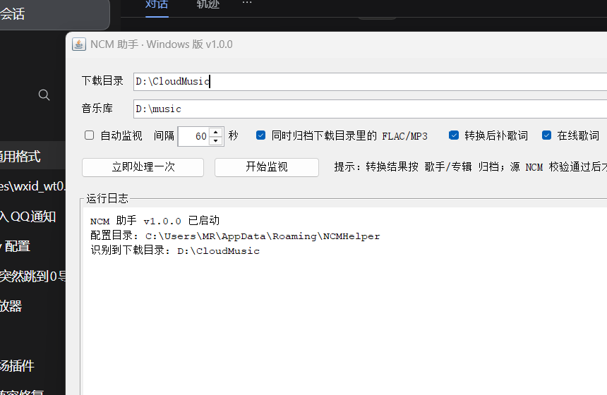

# NCM 助手 · Windows 桌面版

把网易云音乐下载的 `.ncm` 文件**批量自动**转换成通用格式，整理进你的音乐库。



> **English**: A standalone Windows desktop app that automatically decrypts NetEase Cloud Music `.ncm` files into the original FLAC/MP3 (bit-exact, no re-encoding), archives them as `Artist/Album`, embeds cover art and fetches lyrics. Portable build, bundled Java runtime, no installation required.

## 功能

| 功能 | 说明 |
| --- | --- |
| 自动识别下载目录 | 读取网易云客户端下载数据库 `webdb.dat`，也支持手动指定（多个用 `;` 分隔） |
| NCM 无损解密 | 输出原始 FLAC/MP3，**逐字节还原、不重编码** |
| 自动归档 | 按 `歌手/专辑/歌手 - 歌名.ext` 写入音乐库，非法字符自动清洗 |
| 内嵌封面 | 写入 FLAC `PICTURE` 元数据块；已有封面不覆盖 |
| 在线补歌词 | 按歌名/歌手匹配网易云歌词（含翻译），保存 `.lrc` |
| **转换记录** | 保存最近的成功/跳过/失败记录（时间、歌曲、目标文件），按保留天数**自动过期清理** |
| 自动监视 | 定期扫描下载目录，可配置间隔；也可随时"立即处理一次" |
| 命令行模式 | `NCM Helper.exe --cli --source <目录> --library <目录>`，便于脚本化 |
| 零依赖 | 纯 Java（仅 JDK 标准库），自带精简运行时，解压即用 |

### 安全设计

- **先写后删**：输出通过"音频帧逐字节比对"校验后才删除源 NCM
- SHA-1 状态记录 + 音频内容比对，重复下载不会重复入库
- 解析失败保留源文件；下载目录与音乐库重叠时自动跳过
- 流式处理，峰值内存与文件大小无关（10MB NCM 转换 < 1 秒）

## 下载与使用

1. 从 [Releases](../../releases) 下载 `NCM-Helper-Windows-*.zip`
2. 解压到任意目录（无需安装），双击 `NCM Helper.exe`
3. 首次启动会自动识别网易云下载目录；确认"音乐库"路径（默认 `D:\music`）
4. 点击 **立即处理一次**，或勾选 **自动监视** 后点 **开始监视**
5. 点 **转换记录** 可查看最近的转换结果，并调整记录保留天数

> 软件不需要管理员权限；配置与日志保存在 `%APPDATA%\NCMHelper`。

## 命令行模式

```bat
REM 处理指定目录
"NCM Helper.exe" --cli --source "D:\CloudMusic" --library "D:\music"

REM 不联网抓歌词 / 只处理 NCM 不移动已有音频
"NCM Helper.exe" --cli --no-lyrics --no-move-audio

REM 查看帮助
"NCM Helper.exe" --help
```

输出示例：

```
RESULT converted=1 moved=0 skipped=0 failed=0
```

退出码：`0` 成功；`1` 有失败项；`2` 异常。

## 数据目录

```
%APPDATA%\NCMHelper\
├── config.json        # 界面配置
├── history.jsonl      # 转换记录（超期自动清理，默认保留 30 天）
├── ncm-helper.log     # 运行日志
└── lyrics-cache\      # 歌词缓存
```

## 已验证

- Windows 11 实测：图形界面、监视模式、命令行模式均正常
- 转换结果与源音频**逐字节一致**；FLAC 封面写入后音频帧不变
- 10MB NCM 转换 < 1 秒；连续运行无内存问题
- `python run_tests.py`：核心解密、归档流水线、转换记录、打包后 CLI 端到端全部通过

## 构建

需要 **JDK 17+**（含 `javac`/`jar`/`jpackage`），可用 `JAVA_HOME` 指定。

```bat
python build.py              REM 编译 + jpackage 便携应用 + ZIP（产物在 build/）
python build.py --jar-only   REM 只构建 jar（快速验证）
python run_tests.py          REM 自测
```

构建产物：

- `build/NCM-Helper-Windows-1.1.1.zip` — 便携版（含精简 Java 运行时，解压即用）
- `build/app/NCM Helper/` — 未压缩的应用目录
- `build/dist/ncm-helper.jar` — 纯 jar（可配合任意 JDK 17+ 运行）

CI（GitHub Actions）在每次提交时构建并运行测试，打 `v*` 标签时自动创建 Release。

## 项目结构

```
src/main/java/io/github/spwncm/ncmdesktop/
├── App.java            # 入口：GUI / CLI 分发
├── MainWindow.java     # Swing 界面
├── Cli.java            # 命令行模式
├── Settings.java       # 配置读写（%APPDATA%）
├── Pipeline.java       # 下载目录识别、扫描、转换流水线、监视
├── NcmDecoder.java     # NCM 容器解析 + 流式 AES/RC4 解密
├── FlacCover.java      # FLAC PICTURE 内嵌与音频帧校验（流式）
├── NeteaseLyrics.java  # 网易云搜索/歌词/匹配/缓存/LRC 生成
├── Organizer.java      # 命名清洗、路径规划、标签读取、歌词跟随
├── Json.java           # 极简 JSON 解析
└── Log.java            # 日志（文件 + 界面回调）
test/java/              # 自测（自包含合成样本）
test/tools/             # 合成 NCM/FLAC/JPEG 的测试工具
assets/icon.ico         # 应用图标
```

## 免责声明

本项目仅用于**个人已合法下载的音乐文件**的格式转换与整理，不提供任何音乐内容，
不绕过任何付费/版权机制。请勿传播转换后的受版权保护音频。
项目与网易云音乐、Salt Player 官方均无关联。

## License

[MIT](LICENSE)
